# Entornos

El juego transcurre dentro de un sistema digital en deterioro, recorrido en **tres niveles de desplazamiento lateral** que avanzan en horizontal mientras suben y bajan entre plataformas. Todo el escenario se construye con un **tileset de `32 × 32` píxeles** producido en PixelLab: bloques de piedra oscura en gris carbón con vetas y bordes luminosos en verde azulado, cables rojos y detalles tecnológicos. Las trampas comparten ese mismo lenguaje visual para pasar desapercibidas hasta que se activan.

## Zonas
Las tres zonas son **estados visuales del sistema** que se mezclan dentro de los tres niveles. A medida que se avanza, el deterioro aumenta y la zona dominante cambia.

| Zona                                | Estilo                                                                                                          | Elementos                                                                                        | Función                                                                                                                                   | Predomina en |
| ----------------------------------- | --------------------------------------------------------------------------------------------------------------- | ------------------------------------------------------------------------------------------------ | ----------------------------------------------------------------------------------------------------------------------------------------- | ------------ |
| Zona Inicial (Demo del Juego)       | Estructuras limpias y ordenadas, aspecto inofensivo                                                             | Bloques de tierra/piedra simples, plataformas sólidas, fondos estáticos y metas aparentes        | Introducir las mecánicas básicas y generar una falsa sensación de familiaridad y seguridad antes de activar las trampas troll.            | Nivel 1      |
| Zona Inestable (Código Corrupto)    | Entorno retro con fallos visuales, estructuras desgastadas y fragmentadas.                                      | Plataformas invisibles/falsas, trampas móviles inesperadas, picos emergentes y bloques que caen. | Desafiar la paciencia y capacidad de observación del jugador mediante el aprendizaje por fallo y la sorpresa                              | Nivel 2      |
| Zona Colapsada (Sistema Abandonado) | Escenarios oscuros con tonos gris carbón y rojo oscuro, estética de glitch severo y deterioro digital avanzado. | Trampas combinadas, láseres y plataformas que se destruyen                                       | Representar el punto culminante de la historia donde el sistema deteriorado intenta evitar a toda costa que el jugador complete el juego. | Nivel 3      |

## Medidas en Unity

Una celda del tileset equivale a **una unidad de Unity**. Emmet ocupa una celda, y las alturas de salto de [[02 - Mecánicas]] se miden en esas mismas celdas.

| Aspecto                       | Medida objetivo                                                                                    |
| ----------------------------- | -------------------------------------------------------------------------------------------------- |
| Celda de la cuadrícula        | `32 × 32` píxeles = `1 × 1` unidad (`32` píxeles por unidad)                                       |
| Cámara                        | Ortográfica con componente _Pixel Perfect Camera_, resolución de referencia `640 × 360`            |
| Área visible                  | `20 × 11` celdas aproximadamente (tamaño ortográfico `5,625`); escala exacta `3×` en `1920 × 1080` |
| Salto leve / máximo           | `2` / `4` celdas                                                                                   |
| Desnivel entre plataformas    | `4` celdas o menos                                                                                 |
| Nivel 1 - El Despertar        | `100–150` celdas de largo y `20–30` de alto                                                        |
| Nivel 2: Desafío de Datos     | `150–220` celdas de largo y `25–35` de alto                                                        |
| Nivel 3 - El Umbral de Salida | `200–300` celdas de largo y `30–40` de alto                                                        |
Cada nivel se monta sobre un *Grid* con capas de *Tilemap*: fondo, decoración trasera, terreno (única capa con colisión, con *Composite Collider 2D* y material físico de fricción cero), jugador y decoración frontal. Las trampas, la palanca, la llave, los puntos de control y la meta se colocan como *prefabs*.
## Tileset

Tileset de `32 × 32` px hecho en PixelLab: piedra gris carbón con borde superior y vetas en verde azulado, cables rojos y detalles tecnológicos.

| Grupo                               | Piezas                                                                                                                                | Uso                                                          |
| ----------------------------------- | ------------------------------------------------------------------------------------------------------------------------------------- | ------------------------------------------------------------ |
| Pisos rectos                        |                                                                              | Suelo principal y tramos seguros                             |
| Esquinas                            | 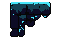 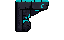                                                                    | Uniones entre suelo y pared                                  |
| Plataformas pequeña flotante        |                                                             | Saltos de precisión                                          |
| Bloque solido                       |                                                                                              | Obstáculos y escalones                                       |
| Bloque con detalle tecnologico      |                                                          | Puntos de interes visual, zona inicial                       |
| Pared vertical / columna            |                                                                          | Límites verticales y muros                                   |
| Bordes de plataformas               |                                                                     | Cierre de las formas del terreno                             |
| Plataformas agrietadas / con glitch |                                                                    | Zonas inestables y colapsada                                 |
| Variantes decorativas               |                                                                     | Ambientación sin función jugable                             |
| Elementos adicionales               |   | Relleno de detalle en la capa de decoración                  |
| Punto de muerte                     |                                                                                             | Plataforma que indica el punto de muerte mediante una mancha |
## Trampas
Todas las trampas matan a Emmet al instante. Solo los **picos** usan el rojo oscuro de peligro. El resto comparte el verde azulado del entorno, de modo que se confunden con el escenario o con objetos inofensivos, tal como pide la regla de visibilidad engañosa de [[01 - Dirección de Arte]].

| Trampa           | Imagen                                                                                | Comportamiento Visual                                                                                               |
| ---------------- | ------------------------------------------------------------------------------------- | ------------------------------------------------------------------------------------------------------------------- |
| Picos            |                                                   | Fila de picos rojos fija sobre el suelo; el único peligro visible a simple vista                                    |
| Pico que cae     |                                           | Estalactita azul oscura colgada del techo que cae cuando Emmet pasa por debajo                                      |
| Planta           | 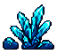                                                      | Variante que parece decoración; permanece quieto y se lanzan hacia Emmet cuando se acerca                           |
| Láser            | 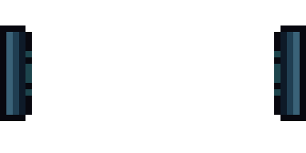                                               | Emisores en los extremos y haz que se forma, se mantiene, se distorsiona y se disipa, en tres niveles de intensidad |
| Plataforma falsa | 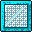                           | Bloque translúcido que parece sólido y desaparece o deja caer a Emmet al pisarlo                                    |
| Diamante falso   |                                        | Imita un coleccionable con núcleo brillante; mata al tocarlo                                                        |
| Bloques que caen | 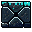 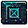 | Pieza del terreno que se desprende al pisarla o al pasar bajo ella                                                  |
## Elementos del nivel

#### Palanca
Único elemento interactivo con animación propia. Se activa cuando **Emmet la empuja** mientras camina hacia ella, sin necesidad de un botón de acción. 

| Estado     | Fotograma                                             | Tratamiento                                        |
| ---------- | ----------------------------------------------------- | -------------------------------------------------- |
| Inactiva   | 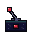  | Manivela inclinada a la izquierda, luz roja        |
| Transicion |  | Manivela en recorrido, la luz cambia de color      |
| Activada   | 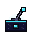   | Manivela inclinada a la derecha, luz verde azulada |

---

| Elemento   | Fotograma                | Tratamiento                                                                                                                  |
| ---------- | ------------------------ | ---------------------------------------------------------------------------------------------------------------------------- |
| Checkpoint | 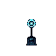 | puntos de reaparición (_checkpoints_).                                                                                       |
| Llave      | 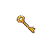         | Al recogerla pasa a la siguiente interfaz; se pierde si Emmet muere antes de un nuevo punto de control ([[02 - Mecánicas]]). |
| Metas      | 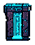              | puertas de finalización de nivel bloqueada hasta llevar la llave.                                                            |

## Capas de fondo (Parallax Backgrounds
Fondos retro oscuros tipo rejilla o degrados simples aplicables a toda una zona , utilizando tonos más apagados que el terreno para no competir con las plataformas ni con las trampas.

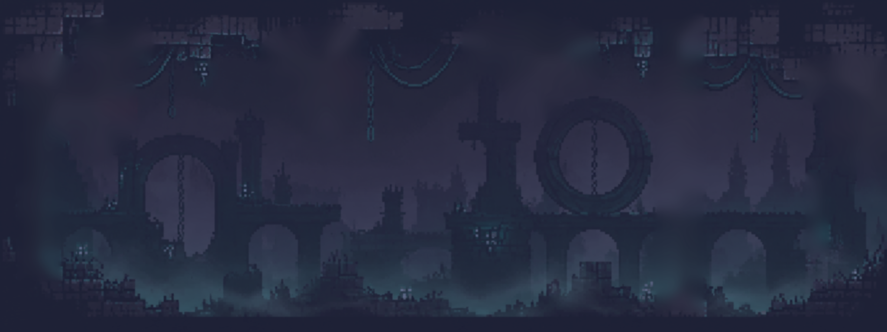

## Modularidad

- El mismo tileset sirve para las tres zonas; la Inestable y la Colapsada sustituyen piezas por sus variantes agrietadas y con *glitch*.
- *Prefabs* comunes: cada trampa, palanca, llave, punto de control y puerta de meta.
- Las trampas reutilizan el mismo *prefab* en varios niveles y solo cambian su comportamiento sorpresa.
## Iluminación
La iluminación es **plana y uniforme**, sin luces dinámicas ni sombras en tiempo real, manteniendo la fidelidad visual de los juegos de plataformas 2D de la época de los 2000.. El brillo lo aportan los propios sprites: las vetas verde azulado del tileset, para resaltar plataformas interactivas o elementos clave de la interfaz/escenario.

## Efectos visuales

- **Partículas:** Polvo retro pixelado al saltar o aterrizar; fragmentos de píxeles al romperse un bloque o destruirse una plataforma.
- Muerte de Emmet: disolución en píxeles sueltos y mancha persistente en el punto de muerte.
- **Impactos:** Explosión o disolución en píxeles sueltos del sprite del jugador al colisionar contra trampas.
- **Vacío:** caer fuera de la pantalla mata a Emmet; no hay agua ni fluidos.

> **Navegación:** [[00 - Índice]] · ← [[02 - Personajes y Animación]] · [[04 - Interfaz Visual]] →
