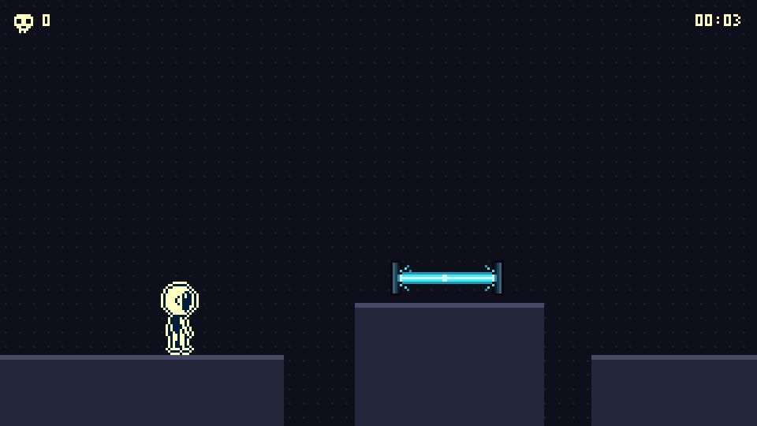
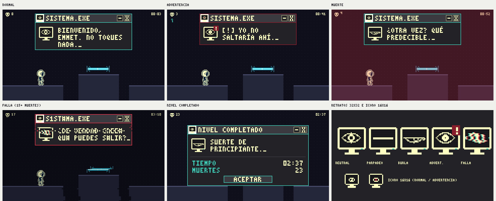

# Interfaz Visual

La interfaz imita las ventanas de un sistema operativo antiguo: es el terreno de Sistema.exe. Es mínima durante el juego para que la atención quede en las trampas. La estructura de menús se define en [[02 - UI y Menús]].
## HUD

La interfaz es minimalista para mantener la pantalla despejada y centrar la atención en los obstáculos y trampas del nivel.

| Elemento                  | Posición                    | Descripción                                                                                                                                       |
| ------------------------- | --------------------------- | ------------------------------------------------------------------------------------------------------------------------------------------------- |
| Contador de muertes       | Arriba a la izquierda       | Icono de calavera y número acumulado de la partida; el número da un pequeño salto cada vez que sube.                                              |
| Cronómetro                | Arriba a la derecha         | Tiempo transcurrido en formato `MM:SS`; se detiene en pausa.                                                                                      |
| Llave                     | Bajo el contador de muertes | Icono que aparece al recoger la llave y desaparece si se pierde al morir.                                                                         |
| Mensajes de Sistema.exe   | Arriba al centro            | Cuadro de texto que aparece al morir o al llegar a ciertos puntos, con texto escrito letra por letra y sonido; se cierra solo tras unos segundos. |
| Indicaciones contextuales | Abajo al centro             | Solo en el tutorial del Nivel 1 (ejemplo: _"Presiona `[Espacio]` para saltar"_ o _"Presiona `[R]` para reiniciar"_).                              |
No hay barra de vida, energía, munición, mapa ni inventario.

---
## Jerarquía visual

- . **Área de juego:** Emmet, plataformas y trampas, siempre libres de elementos del HUD.
2. **Mensajes de Sistema.exe.**
3. **Contador de muertes y llave.**
4. **Cronómetro e indicaciones contextuales.**
---
## Sistema.exe

Sistema.exe no tiene cuerpo: es el programa que controla el nivel y solo se manifiesta a través de sus ventanas. Su "cara" es un icono de programa antiguo (un ojo dentro de un monitor), y su personalidad se transmite con el texto, el color de la ventana y pequeñas fallas visuales. Nunca aparece dentro del área de juego.

#### Estructura de la ventana

| Parte           | Descripción                                                                                                |
| --------------- | ---------------------------------------------------------------------------------------------------------- |
| Barra de titulo | Gris carbón más claro, con el texto a la ziquierda de `El sistema`.                                        |
| Retrato         | Icono de `32 × 32` px a la izquierda del texto, con la expresión del mensaje.                              |
| Botones         | `[-]` y `[X]` a la derecha. Son decorativos: Emmet no puede cerrar a Sistema.exe.                          |
| Cuerpo          | Fondo gris carbón, borde recto de 1 px y texto crema alineado a la izquierda, de 1 a 3 líneas como máximo. |
| Cursor          | Guion bajo (`_`) parpadeando al final del texto mientras escribe y al terminar.                            |
- **Posición:** arriba al centro, sin tapar el área de juego.
- **Tamaño:** ancho fijo de aproximadamente el 60 % de la pantalla; el alto depende del número de líneas.

#### Comportamiento del texto
- **Aparición:** la ventana aparece de golpe (_pop-up_) con un parpadeo de un fotograma, sin transiciones suaves.
- **Escritura:** letra por letra, a unos 30–40 caracteres por segundo, con un sonido corto por letra (ver [[05 - Audio y Música]]).
- **Tipografía:** Press Start 2P en mayúsculas, de 14 a 16 pt, en crema sobre gris carbón.
- **Cierre:** se cierra sola unos 3 segundos después de terminar de escribir, también de golpe.
- **Prioridad:** si llega un mensaje nuevo, reemplaza al anterior en lugar de apilarse.

## Estados de la Ventana

| Estado               | Representación                                                                |
| -------------------- | ----------------------------------------------------------------------------- |
| Normal               | Ventanas limpias en gris carbón, texto crema y bordes rectos.                 |
| Advertencia          | Cuadro de Sistema.exe con borde e icono `[!]` en rojo oscuro.                 |
| Muerte               | Destello rojo breve con *glitch* o parpadeo CRT; el contador de muertes sube. |
| Éxito                | Ventana emergente «Nivel completado» con borde verde azulado.                 |
| Acción no disponible | Opción en gris (por ejemplo, Continuar sin partida guardada).                 |

## Convenciones

- **Tipografía:** Press Start 2P (o tipografías pixeladas similares) para mantener el estilo retro de los años 2000.

- **Iconografía:**  iconos de `16 × 16` px en pixel art con estética de sistema operativo antiguo (botones de cerrar `[X]`, minimizar `[-]`, cursores retro e íconos de advertencia `[!]`).

- **Tamaños mínimos:**
	- Texto en pantalla _8pt - 10pt para subtítulos e indicaciones.
	- Títulos de menús / Mensajes del Sistema: 14pt- 16pt para fácil lectura.

- **Contraste:** Contraste elevado asegurado utilizando fondo oscuro gris carbón  con texto en crema o verde azulado

- **Animaciones:** Animación de parpadeo de cursor de texto (`_`), apariciones instantáneas tipo "pop-up" sin transiciones suaves, y parpadeo breve (_blink_) en diálogos del Sistema.

## Pantallas

- **Menú principal:** escritorio de un software antiguo con Nueva partida, Continuar, Configuración y Salir.
- **Pausa:** ventana flotante sobre el juego con Continuar, Reiniciar nivel, Configuración y Salir al menú.
- **Configuración:** Audio, Video, Controles y Accesibilidad.
- **Nivel completado:** tiempo, muertes y un comentario mordaz de Sistema.exe.
- **Desenlace:** elección final entre Salir y Quedarse.
- **Ranking:** introducir el apodo para enviar muertes y tiempo a la app móvil.

No hay pantalla de derrota: Emmet reaparece al instante.

> **Navegación:** [[00 - Índice]] · ← [[03 - Entornos]] · [[05 - Audio y Música]] →
